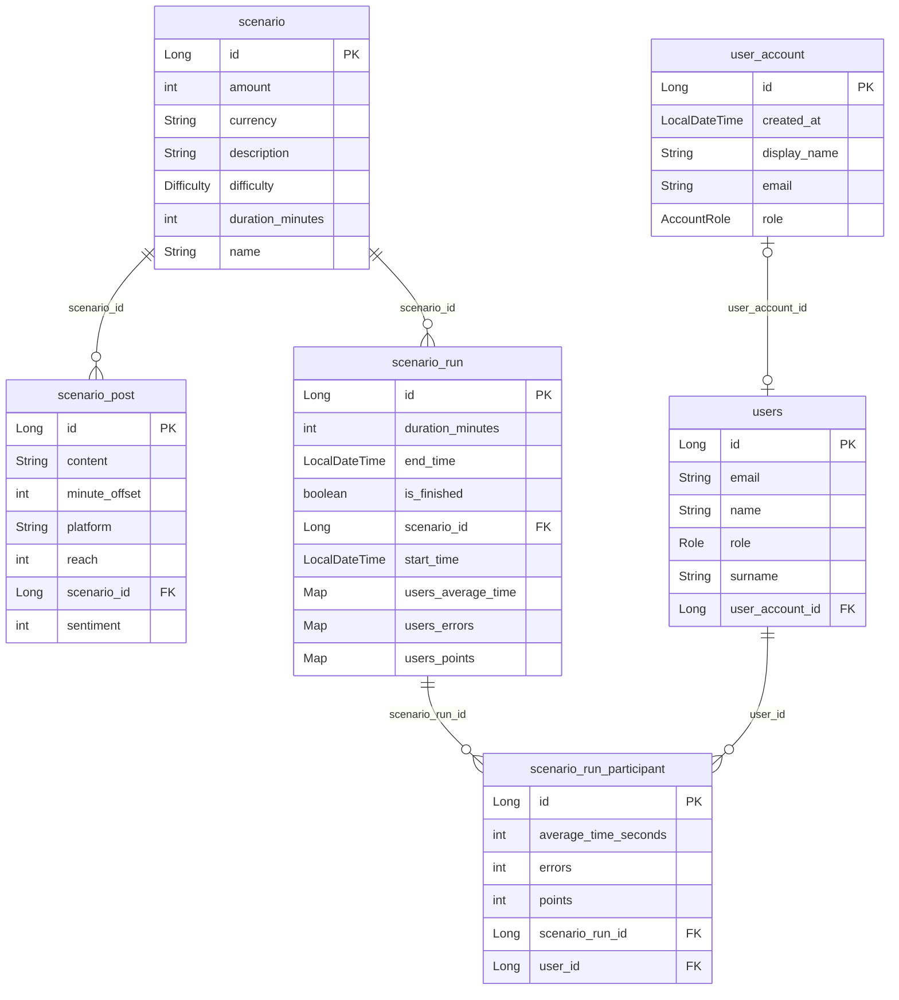

# Schemat bazy danych

Plik generują reguły projektu (panel Maven → Lifecycle → verify). Nie edytujcie go ręcznie.

Tabele: 6 · kolumny: 40 · relacje: 4 × @ManyToOne, 1 × @OneToMany, 1 × @OneToOne, 0 × @ManyToMany

| Tabela | Encja | Kolumny | Klucze obce |
|---|---|---|---|
| scenario | Scenario | 7 | — |
| scenario_post | ScenarioPost | 7 | scenario_id |
| scenario_run | ScenarioRun | 9 | scenario_id |
| scenario_run_participant | ScenarioRunParticipant | 6 | scenario_run_id, user_id |
| user_account | UserAccount | 5 | — |
| users | Users | 6 | user_account_id |

